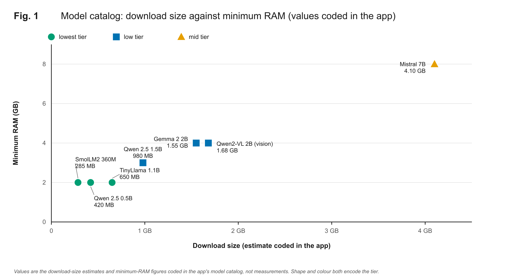
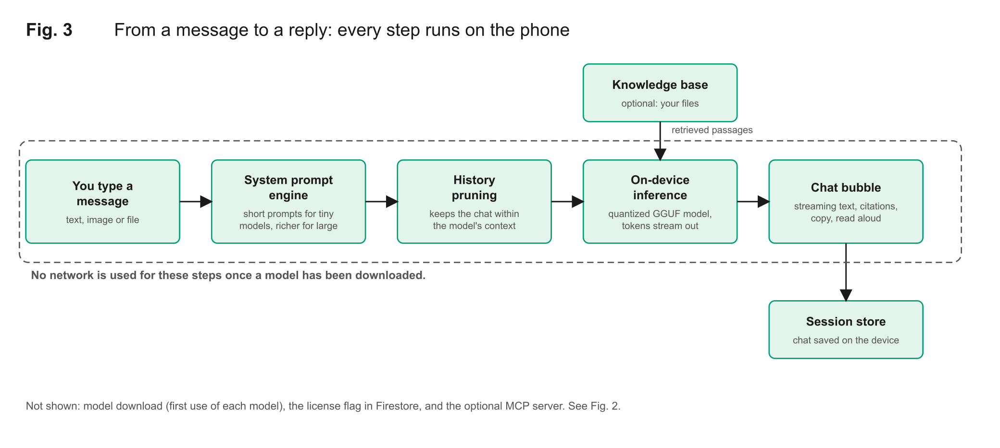

# Eliora AI

A Flutter assistant that runs small language models **on your phone**. Chat inference happens on the device through quantized GGUF models, so your prompts and the replies are not sent to a server. Built as my final-year project at Ghazi University (BS Information Technology, 2026).

> **Status:** working Android app, not a store release. There are no automated tests yet, and I have not published benchmark numbers because I have not measured and recorded them. Where this README says something is *not* verified, it means exactly that.

## The problem it fixes

Most AI assistants need an internet connection, a subscription or a usage cap, and they send what you type to someone else's server. That excludes people on weak connections or tight budgets, and it is uncomfortable for anything personal. Eliora downloads a model once, then answers from the device: no per-message cost, no usage limit, and chats keep working offline after the model is on the phone.

## Features (as implemented in the code)

- **On-device chat with streaming replies**, powered by [`flutter_local_agent_kit`](https://pub.dev/packages/flutter_local_agent_kit)
- **Model explorer** with seven quantized models, each tagged with a device tier and a minimum RAM; the app reads the phone's RAM and warns about models it will struggle with (compatibility dialog)
- **Model downloads** with a progress overlay, a foreground-service notification, a cancel button, and cleanup of a half-finished download at the next start (an interrupted download restarts; it does not resume)
- **Per-model system prompts and context limits**: tiny models get very short, direct prompts; larger ones get richer instructions
- **Saved conversations** in a session drawer, persisted on the device
- **Knowledge base**: attach files and have answers draw on them, with citation chips shown under the reply
- **Image and file attachments**; a vision-capable model (Qwen2-VL 2B) can describe pictures
- **Read-aloud** replies with text-to-speech
- **Optional MCP connection**: link an MCP server you run yourself by URL
- **Code blocks** with copy, Markdown rendering, light and dark themes, and an onboarding tutorial

## Models in the catalog

All are Q4_K_M quantized GGUF files downloaded from Hugging Face the first time you choose them.

| Model | Download size | Device tier | Minimum RAM | Notes |
| --- | --- | --- | --- | --- |
| SmolLM2 360M Instruct | 285 MB | lowest | 2 GB | text only |
| Qwen 2.5 0.5B Instruct | 420 MB | lowest | 2 GB | text only |
| TinyLlama 1.1B Chat | 650 MB | lowest | 2 GB | text only |
| Qwen 2.5 1.5B Instruct | 980 MB | low | 3 GB | |
| Gemma 2 2B IT | 1.55 GB | low | 4 GB | |
| Qwen2-VL 2B Instruct | 1.68 GB | low | 4 GB | **vision** |
| Mistral 7B Instruct v0.2 | 4.1 GB | mid | 8 GB | needs a high-end phone |

Sizes are the estimates coded in the app; real files can differ slightly.



*Figure 1. The model catalog: download size against minimum RAM, with the device tier encoded by both shape and colour. These are the values coded in the app, not measurements.*

## How it is built


*Figure 2. Architecture and data boundary. Green blocks stay on the phone. Dashed orange-red blocks use the network, and each is paired with the external service it talks to.*



*Figure 3. From a message to a reply. Once a model is downloaded, none of these steps needs the network.*

The app is one large file, `lib/main.dart` (about 6,000 lines), organised in numbered sections: license service, colour tokens, theme, device RAM, system prompts, model catalog, sessions, download notifier, chat bubble, welcome view, full chat view, model explorer, dialogs, MCP and knowledge sheets, app entry point and the main page. Splitting it into feature modules is on the roadmap.

## What is and is not private

Be precise about this, because "private" is easy to over-claim:

- **On the device:** the conversation, the model weights after download, and inference.
- **Network, first use of a model:** the model file is downloaded from Hugging Face.
- **Network, always:** the app starts Firebase and listens to one Firestore document (`license/status`, field `is_locked`) that works as a **remote on/off switch**. It does not read your chats, but it means the app can be locked remotely. If you fork this project and want a fully offline, unlockable app, remove `LicenseService` from `lib/main.dart` and the Firebase dependencies.
- **Permissions declared in the Android manifest:** internet, notifications, foreground service (downloads), receive boot completed, camera, record audio, modify audio settings.

## Run it

You need the Flutter SDK (Dart `^3.11.3`) and an Android device or emulator. This repository contains the Android project only (no iOS folder).

```bash
git clone https://github.com/waqasulhaqqureshi/eliora-ai.git
cd eliora-ai
flutter pub get
```

Firebase config is **not** included. Either create your own Firebase project and run `flutterfire configure`, or copy the templates and fill them in:

```bash
cp lib/firebase_options.dart.example lib/firebase_options.dart
cp android/app/google-services.json.example android/app/google-services.json
```

Then `flutter run` (debug) or `flutter build apk --release`. Initialisation errors are caught, so the app still starts if Firebase is not configured, but the license listener will not work.

Tips: start with SmolLM2 360M or Qwen 2.5 0.5B on a phone with 3 to 4 GB of RAM; a 7B model needs a flagship phone and will be slow elsewhere.

## Project layout

```
lib/main.dart                       app, UI, model catalog, chat, license listener
lib/firebase_options.dart.example   template for your own Firebase config
android/                            Android host project
assets/                             icons and splash images
figures/                            diagrams used in this README (PNG and SVG)
```

## Not verified yet

- Measured speed (tokens per second), memory use, battery drain or answer quality per model and device
- Behaviour on devices other than the ones I tried
- Automated tests (there are none)
- iOS (no iOS project is included)

## Roadmap

1. Measure and publish latency, memory, battery and quality per model and device, reproducibly
2. Split `main.dart` into feature modules and add tests
3. Make the Firebase license switch optional
4. Add screenshots and a short screen recording to this README

## Author

Waqas Ul Haq Qureshi, [heywaqas.live](https://heywaqas.live)
